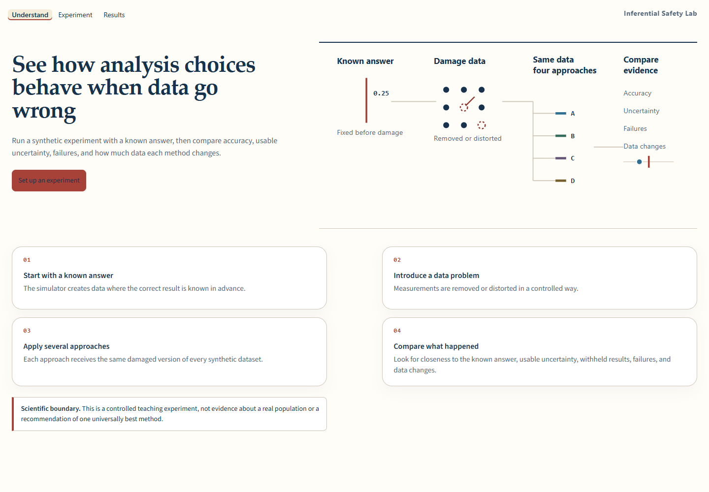
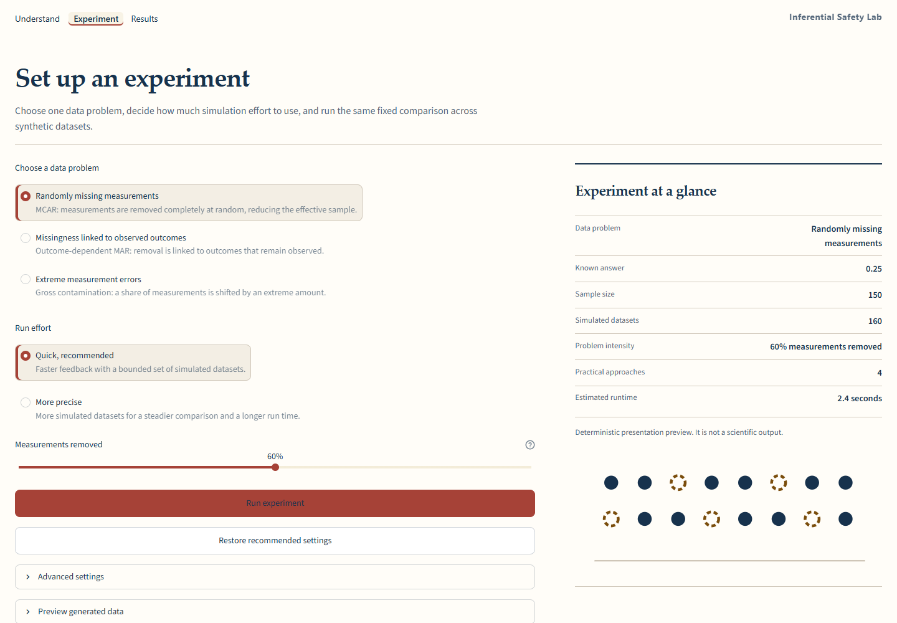
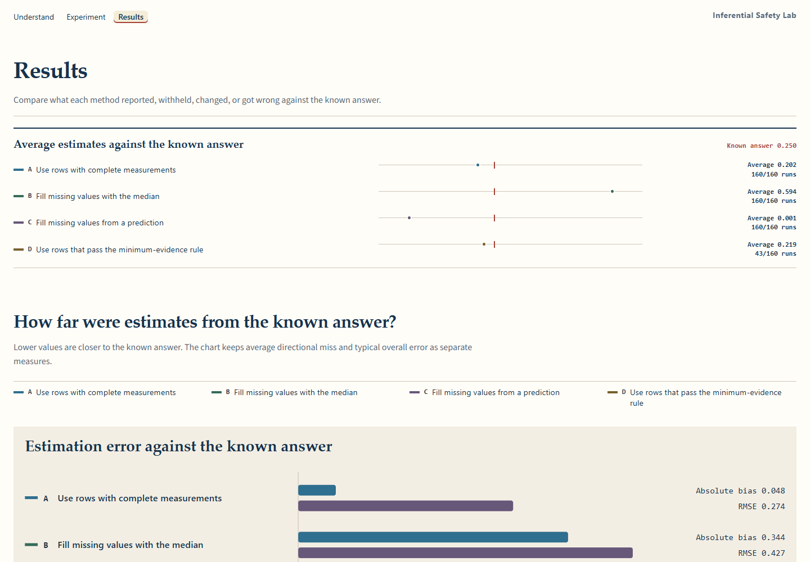
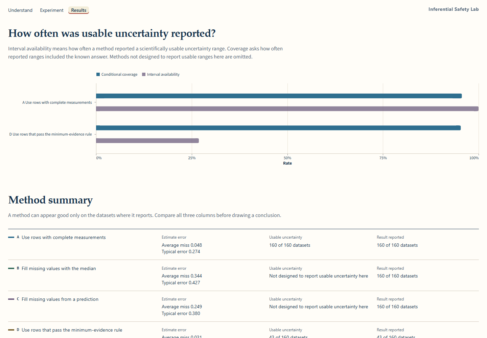
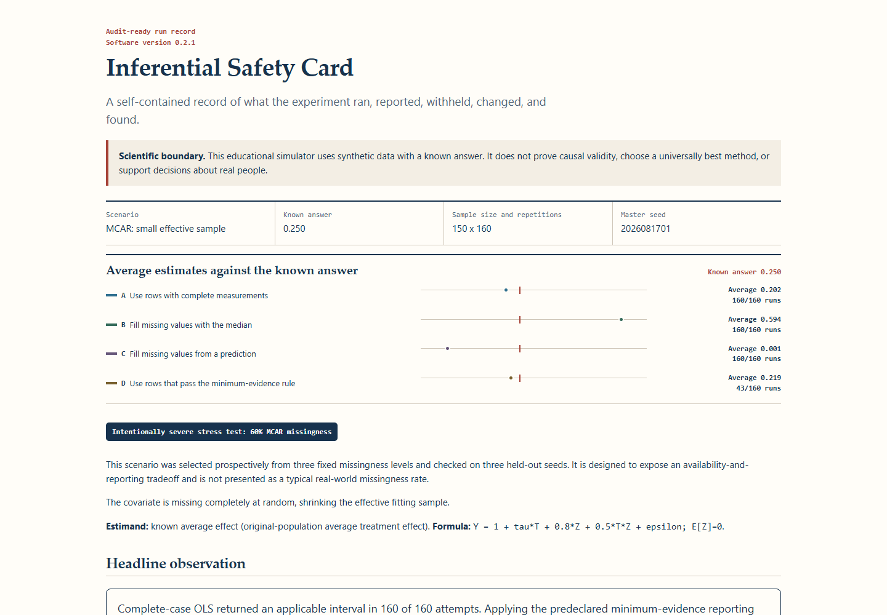
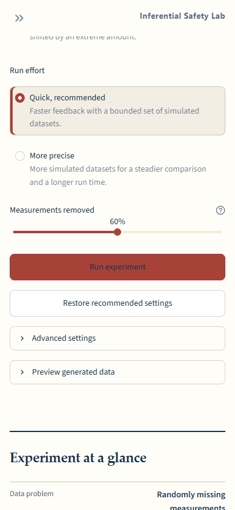
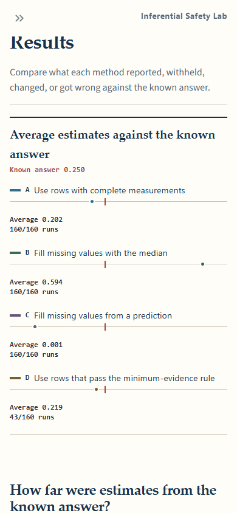
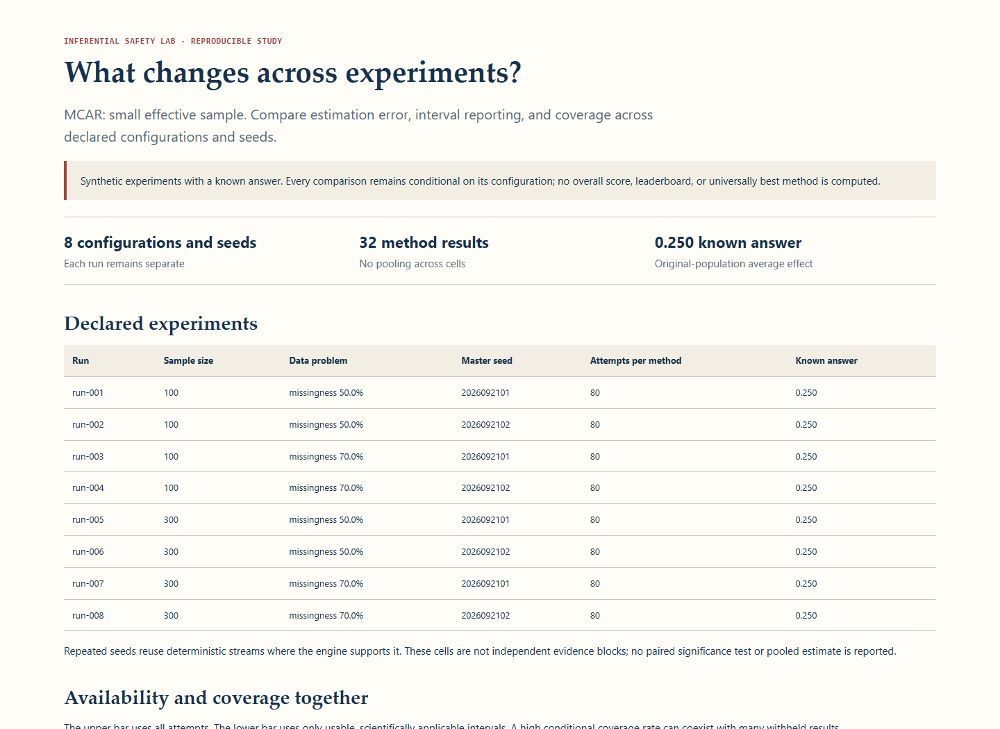

# Inferential Safety Lab: interface walkthrough

[Project overview](../README.md) · [Demo script](demo-script.md)

The application uses synthetic data with a known answer. These views illustrate
analysis and reporting choices; they do not validate a method for real-world
decisions. The offline study report keeps each configuration and seed separate.

## Understand the experiment

## Configure a simulation

## Read the result summary

## Compare estimates and uncertainty

## Review the standalone Safety Card

## Experiment controls on mobile

## Known-answer result on mobile

## Offline study report

